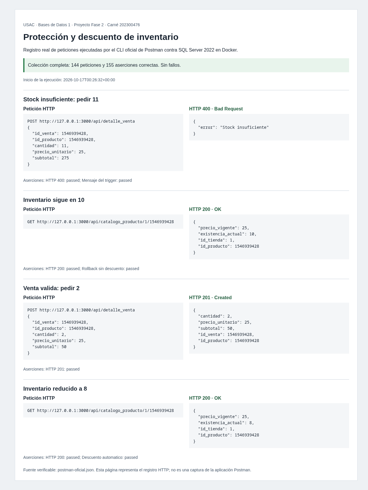
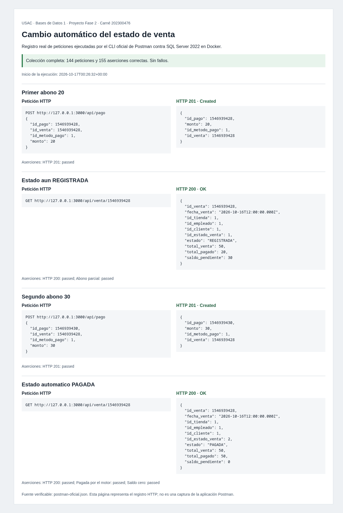

# Evidencias de ejecución

Se ejecutaron las pruebas sobre SQL Server 2022 en Docker. Toda manipulación de registros de negocio se realizó mediante HTTP.

| Verificación | Resultado |
|---|---|
| Importación histórica | 9,068 filas; comparación de todos sus campos antes del commit. |
| Validación de entradas e importación concurrente | 4 pruebas correctas. |
| Integración HTTP | 8 escenarios correctos: CRUD, errores, ajustes, abonos, lotes, concurrencia, anulaciones y referencia completa de reportes. |
| Colección con CLI oficial de Postman | 144 peticiones, 155 aserciones, 0 fallos. |
| Persistencia | Importación y venta pagada idénticas antes y después de reiniciar SQL Server. |
| Dependencias | `npm audit`: 0 vulnerabilidades al verificar la entrega. |

## Capturas del registro HTTP

Las imágenes muestran una representación legible de **respuestas reales** guardadas por el CLI oficial de Postman. No representan la interfaz gráfica de Postman. Los HTML correspondientes permiten consultar el registro sin herramientas adicionales.





## Archivos verificables

- `postman-oficial.json`: reporte original del CLI, con peticiones, respuestas y aserciones.
- `integracion.json`: registro de las pruebas HTTP; los listados grandes se guardan como muestras identificadas.
- `persistencia.json`: comparación antes/después del reinicio del contenedor.
- `validacion.json`: resumen de las comprobaciones realizadas.
- `inventario.html` y `pagos.html`: representación de las respuestas originales, usada para las capturas.

Para reproducir:

```bash
npm test
npm run test:integration
npm run postman -- --reporters cli,json --reporter-json-export docs/evidencias/postman-oficial.json
python3 scripts/generate-evidence.py
```

La API debe estar iniciada y el histórico importado para las comprobaciones HTTP. Las pruebas añaden registros `QA`/`Demo` con IDs altos; los conteos actuales pueden superar los 9,068 del histórico. Los IDs de cada ejecución aparecen en las respuestas guardadas.

Las capturas pueden regenerarse abriendo los HTML en un navegador y capturando la página completa. La prueba de persistencia requiere reiniciar SQL Server entre ambas consultas. No se incluyeron credenciales de conexión ni la clave de importación en estos archivos.
